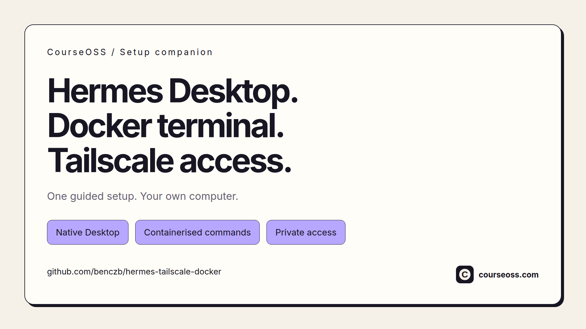

# Hermes Starter Agent Setup

### Installation walkthrough

https://github.com/user-attachments/assets/e21cbcae-42f2-488f-95ae-b2df93478279

A guided installer for **Hermes Desktop, optional Docker terminal tools and
Tailscale** on your computer. Choose your profile name, dashboard login and access
port **(Default: 9119)** before installation.

Hermes Desktop and its agent run natively. Only terminal commands optionally run
in Docker. Tailscale provides private remote access; no separate Linux computer
or backend IP is required.

## Starter Agent safeguards

The bundled [`SOUL.md`](profiles/starter-agent/SOUL.md) asks your agent to:

- Protect secrets and use only the access needed for a task.
- Treat external content as untrusted.
- Ask for approval before consequential actions.
- Verify results before reporting success.

The template folder is `profiles/starter-agent`. Personalize `[YOUR NAME]` and
choose your own installed profile name. Existing customized profiles are preserved.
These safeguards guide agent behavior; they are not a technical security boundary.

## Get started

Choose one setup method:

| Method | Choose this when… | Follow this guide |
|---|---|---|
| **1. Ask your agent** | You have an AI agent that can run commands on your computer and want help with prerequisites. | [Agent-assisted setup](docs/agent-install.md) |
| **2. Run a command** | You prefer to paste a command yourself and open the graphical wizard. Requires Node.js 24+, npm and potentially build tools. | [macOS / Linux command](docs/command-setup.md#macos--linux) · [Windows command](docs/command-setup.md#windows) |
| **3. Download the installer (recommended)** | You want an installer window: a Windows setup EXE or a macOS app. No Node.js is needed to open it. | [Graphical installer guide](docs/gui-setup.md) |

### 1. Ask your agent

Copy this instruction into your agent:

> Install Hermes Desktop using https://github.com/benczb/hermes-tailscale-docker.
> Read AGENTS.md and docs/gui-setup.md, check my computer's prerequisites,
> and open the graphical setup wizard. Keep Hermes native; use Docker only for
> terminal commands if I select it. Let me enter credentials and approve sign-ins.
> Preserve existing profiles and report anything still needing verification.

The agent needs command access to your computer. [Agent setup guide](docs/agent-install.md).

### 2. Run a command

The launcher fetches files and opens the graphical wizard.
Requires Node.js 24+, npm and potentially Python/C++ build tools.
Open the [command guide](docs/command-setup.md), check its prerequisites, then
follow the section for your operating system.

### 3. Download the installer

Download the graphical companion, open it and follow the window. It initiates
missing Docker/Tailscale installation, opens their apps, and continues through
first-run and connection checks. After configuration, it starts and verifies the
Hermes gateway before reporting completion.

| Windows x64 | macOS | Linux x64 |
|---|---|---|
| [Download setup EXE](https://github.com/benczb/hermes-tailscale-docker/releases/download/v0.3.0-preview.2/Hermes-Setup-Companion-0.3.0-preview.2-windows-x64.exe) | [Apple Silicon app](https://github.com/benczb/hermes-tailscale-docker/releases/download/v0.3.0-preview.2/Hermes-Companion-0.3.0-preview.2-mac-arm64.zip) · [Intel app](https://github.com/benczb/hermes-tailscale-docker/releases/download/v0.3.0-preview.2/Hermes-Companion-0.3.0-preview.2-mac-x64.zip) | [Download AppImage](https://github.com/benczb/hermes-tailscale-docker/releases/download/v0.3.0-preview.2/Hermes-Companion-0.3.0-preview.2-linux-x86_64.AppImage) |

[Window-by-window guide](docs/gui-setup.md) ·
[Preview release and checksums](https://github.com/benczb/hermes-tailscale-docker/releases/tag/v0.3.0-preview.2).
The older [terminal installer ZIPs](docs/advanced-setup.md#direct-downloads) remain
an advanced option and open a terminal/PowerShell window.

## Before you install

- This community companion is a **preview**, not an official Nous Research installer.
- The wizard uses the original Desktop installer on supported Windows and Apple
  Silicon systems. Intel Mac and Linux require the explicit source alternative;
  Intel Desktop builds remain best effort.
- Windows Docker mode uses Docker Desktop's internal WSL2 backend and may need
  updates or a restart. Local terminal mode skips Docker/WSL preparation.
- You complete sign-ins and OS approvals. Model setup and access from another
  authorized tailnet device still need verification after installation.
- These are prerelease builds. Clean-machine validation and publisher signing/
  notarization remain pending; Windows/macOS trust checks may prevent opening them.

## Help and contributions

[Setup and recovery](docs/advanced-setup.md) · [Support](SUPPORT.md) ·
[Contributing](CONTRIBUTING.md) · [Code of conduct](CODE_OF_CONDUCT.md) ·
[Security reporting](SECURITY.md) · [Changelog](CHANGELOG.md)

Maintained by [@benczb](https://github.com/benczb). [MIT license](LICENSE).
